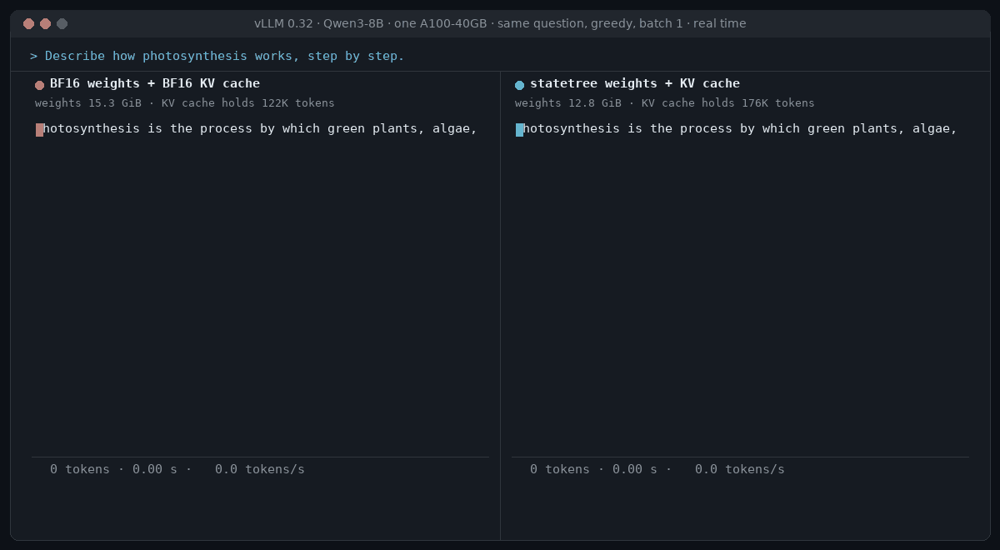
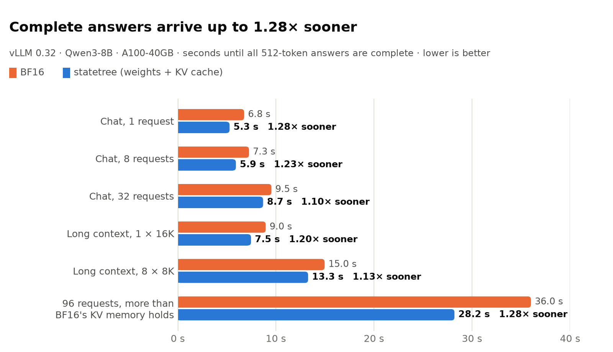
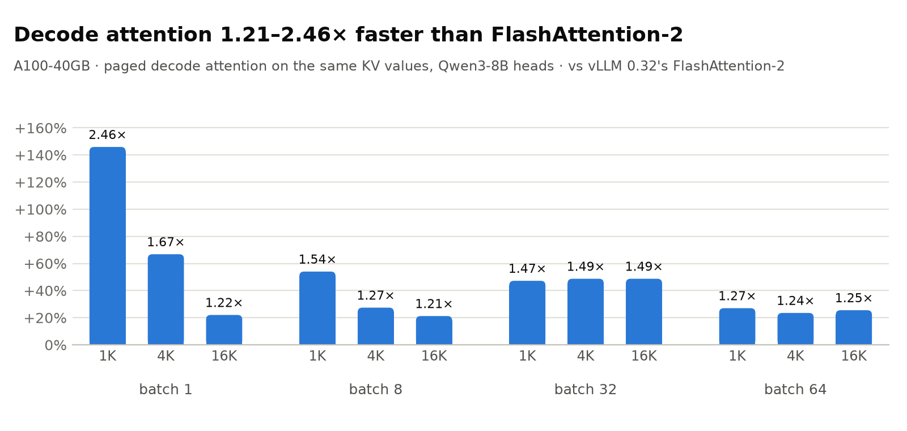
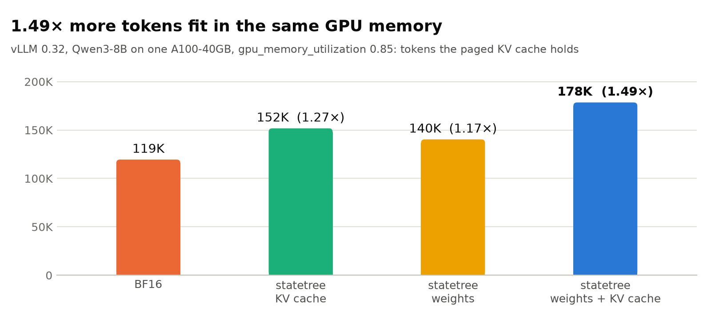
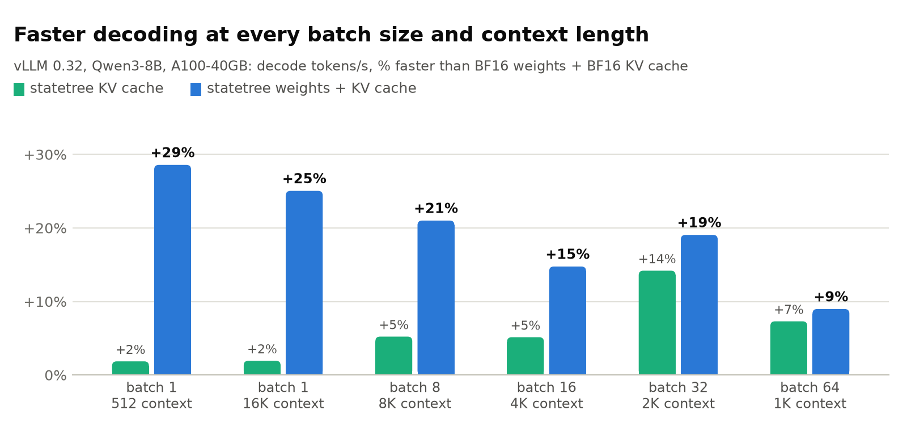
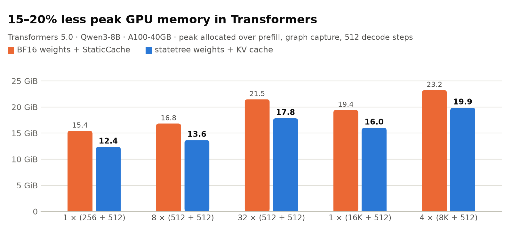

<div align="center">

# statetree 🌳

**Lossless compression of LLM weights *and* KV cache, with fused CUDA kernels for vLLM and 🤗 Transformers.**

Every weight and every cached key / value decodes back to its exact BF16 bits.
No quantization, no calibration, no accuracy trade-off. Just fewer bytes, and faster tokens.
Dense and Mixture-of-Experts models, on one GPU or several.

[](LICENSE)
[](#with-vllm-two-flags)
[](#supported-transformers-versions)
[](#install)
[](#reproducibility-and-hardware)
[](#reproducibility-and-hardware)
[](#about-exactness)



<sub>Qwen3-8B in vLLM 0.32 on one A100-40GB, the same question at batch 1, greedy. Both engines' real answers,
token-for-token identical (256 tokens), replayed at their measured speeds: 3.35 s with BF16, 2.63 s with statetree (1.27× sooner).</sub>

</div>

---

## At a glance

| Qwen3-8B · one A100-40GB · vLLM 0.32 | BF16 | **statetree** |
|---|---:|---:|
| Weights in GPU memory | 15.3 GiB | **12.8 GiB** (−24%) |
| KV cache per token | 144 KiB | **112.5 KiB** (−22%) |
| Tokens the KV cache holds (same 0.85 GPU budget) | 119K | **178K (1.49×)** |
| Decode attention vs FlashAttention-2 | 1.00× | **1.21–2.46×** |
| Generation speed, batch 1 | 75.6 tok/s | **97.2 tok/s (1.29×)** |
| Time to the complete answer | 1.00× | **1.10–1.28× faster** |
| Weights and cached values | original | **bit-identical** |

| Qwen3.6-35B-A3B (MoE, 256 experts) · 2 × A100-40GB, TP = 2 · vLLM 0.32 | BF16 | **statetree** |
|---|---:|---:|
| Weights per GPU | 32.35 GiB | **25.26 GiB** (−22%) |
| Tokens the KV cache holds (same 0.93 GPU budget) | 199.5K | **596.8K (3.0×)** |
| Generation speed, batch 1 / 8 / 32 | 166 / 675 / 1671 tok/s | **185 / 762 / 1828 tok/s (1.11× / 1.13× / 1.09×)** |
| Prefill (16 prompts of 3000 tokens) | 30.8K tok/s | **29.1K tok/s (0.95×)** |
| Weights | original | **bit-identical** |

<sub>The MoE model nearly fills two 40 GB GPUs in BF16, so the 7.2 GiB per GPU that the experts free go straight to the
KV cache. Both engines with a warm torch.compile cache, run back to back (see What's new in 0.5.1 for the corrected
0.5.0 figures).
Greedy answers are not token-for-token identical: two BF16 runs of this model in vLLM already disagree on 2 of our 4
chat prompts (after 27 and 50 tokens), and statetree's answers diverge from BF16's at about the same rate.</sub>

LLM generation is memory-bound: every new token re-reads all the weights and the whole KV cache. statetree stores
both at about **12 bits per value instead of 16**, losslessly, and its kernels read that format directly, decoding
straight into the tensor cores. Fewer bytes per token means faster tokens, and the memory it frees holds more
conversations at once.

---

## Results

### Complete answers, up to 1.28× sooner

<picture>
  <source media="(prefers-color-scheme: dark)" srcset="assets/response_dark.png">
  
</picture>

The two halves help in different places, and together in all of them. State-tree **weights** speed up small batches
(the linear layers read 24% fewer bytes). The state-tree **KV cache** speeds up large batches and long contexts, and
above all helps when memory runs out: with 96 requests, BF16 can keep about 58 of them in its KV cache at once,
statetree about 87, so the whole batch finishes **1.28× sooner**.

### Decode attention faster than FlashAttention-2

<picture>
  <source media="(prefers-color-scheme: dark)" srcset="assets/attention_dark.png">
  
</picture>

Our paged decode-attention kernel reads the state-tree KV pages directly: decoding a key record yields exactly the
tensor-core fragments of Kᵀ, values are transposed in registers, and an online softmax with split-K covers long
contexts. It reads 22% fewer bytes than FlashAttention-2 and is **1.21–2.46× faster** than vLLM 0.32's paged
FlashAttention-2 on the same values (1.2–1.5× from batch 8 up), with the split count vLLM's CUDA graphs use.

### 1.49× more tokens in the same GPU memory

<picture>
  <source media="(prefers-color-scheme: dark)" srcset="assets/capacity_dark.png">
  
</picture>

### Faster decoding at every batch size and context length

<picture>
  <source media="(prefers-color-scheme: dark)" srcset="assets/decode_dark.png">
  
</picture>

### Less peak memory in Transformers

<picture>
  <source media="(prefers-color-scheme: dark)" srcset="assets/hf_memory_dark.png">
  
</picture>

<details>
<summary><b>All numbers</b> (tables, setups and caveats)</summary>

**Setup.** Qwen3-8B, one A100-SXM4-40GB. vLLM 0.32 (torch 2.13, CUDA graphs and `torch.compile` on,
`gpu_memory_utilization` 0.85) and Transformers 5.0 (torch 2.7.1, static-cache decoder in a CUDA graph). Greedy
decoding. Scripts: `examples/vllm_response.py`, `examples/hf_response.py`, `examples/vllm_tps.py`. Exact versions:
[Reproducibility and hardware](#reproducibility-and-hardware).

**Complete answers (vLLM)**: seconds until every request's 512-token answer is complete, prompts prefilled
(prefix caching off), and speed-up vs BF16 weights + BF16 KV cache:

| scenario | BF16 | weights | KV cache | weights + KV cache |
|---|---:|---:|---:|---:|
| chat, 1 request (256-token prompt) | 6.76 s | 1.25× | 1.02× | **5.28 s (1.28×)** |
| chat, 8 requests (512-token prompts) | 7.26 s | 1.19× | 1.02× | **5.93 s (1.23×)** |
| chat, 32 requests | 9.55 s | 1.03× | 1.07× | **8.70 s (1.10×)** |
| long context, 1 × 16K-token prompt | 8.97 s | 1.17× | 1.02× | **7.47 s (1.20×)** |
| long context, 8 × 8K-token prompts | 14.97 s | 1.07× | 1.04× | **13.29 s (1.13×)** |
| 96 requests × (1.5K + 512) tokens | 36.0 s | 1.02× | 1.05× | **28.2 s (1.28×)** |
| KV-cache tokens | 119K | 140K | 152K | **178K** |

**Decode (vLLM)**, tokens/s after the prompt:

| batch × context | BF16 | KV cache | weights + KV cache |
|---|---:|---:|---:|
| 1 × 512 | 75.6 | 77.0 (1.02×) | **97.2 (1.29×)** |
| 1 × 16K | 67.5 | 68.8 (1.02×) | **84.4 (1.25×)** |
| 8 × 8K | 402 | 423 (1.05×) | **487 (1.21×)** |
| 16 × 4K | 797 | 838 (1.05×) | **914 (1.15×)** |
| 32 × 2K | 1433 | 1636 (1.14×) | **1706 (1.19×)** |
| 64 × 1K | 2989 | 3207 (1.07×) | **3257 (1.09×)** |

**Decode attention** (one query token per sequence, Qwen3-8B heads: 32 query / 8 KV, head size 128), µs per call,
L2 flushed before every call, vs vLLM 0.32's paged FlashAttention-2 (block 16) on the same values:

| batch | context 1K | 4K | 16K |
|---:|---|---|---|
| 1 | 53.8 → **21.9 (2.46×)** | 57.0 → **34.1 (1.67×)** | 95.2 → **78.0 (1.22×)** |
| 8 | 72.4 → **47.0 (1.54×)** | 150.3 → **118.0 (1.27×)** | 440.7 → **363.7 (1.21×)** |
| 32 | 171.5 → **116.5 (1.47×)** | 538.1 → **361.8 (1.49×)** | 2001.7 → **1345.8 (1.49×)** |
| 64 | 263.6 → **207.5 (1.27×)** | 914.4 → **740.6 (1.23×)** | 3276.3 → **2610.8 (1.25×)** |

Outputs agree with FlashAttention-2 to within 1e-3 (the softmax weights are rounded to BF16 in both kernels). In a full
decode step attention is only part of the time, hence the 1.02–1.14× from the KV cache alone in the decode table.

**Memory.** Weights: 15.27 → 12.80 GiB in vLLM (including kernel workspaces and the 128 MB escape pool), 15.26 →
11.71 GiB in Transformers. KV cache: 144 → 112.5 KiB per token. Peak GPU memory in Transformers
(`torch.cuda.max_memory_allocated` over prefill, CUDA-graph capture and 512 decode steps):

| requests × (prompt + new) | BF16 + StaticCache | statetree weights + KV cache |
|---|---:|---:|
| 1 × (256 + 512) | 15.44 GiB | **12.37 GiB (0.80×)** |
| 8 × (512 + 512) | 16.83 GiB | **13.64 GiB (0.81×)** |
| 32 × (512 + 512) | 21.46 GiB | **17.84 GiB (0.83×)** |
| 1 × (16K + 512) | 19.42 GiB | **16.00 GiB (0.82×)** |
| 4 × (8K + 512) | 23.24 GiB | **19.86 GiB (0.85×)** |

**Transformers speed.** With the weights as state trees, decode is 1.27× faster at batch 1, 1.15× at 8, 1.07× at 32
and 1.04× at 64. With the state-tree KV cache as well, complete answers in the scenarios above are 1.46× faster at
batch 1 and 2.1–3.9× faster at batch 8–32 and 8K–16K contexts than transformers' StaticCache + SDPA. Most of that
gap is transformers' static-cache path itself (with a mask it copies every KV head per query head and attends over
the whole static length at every step), so read it as "statetree's cache inside transformers", not as the format
alone; the vLLM comparison against FlashAttention-2 is the like-for-like one.

**Prefill** is compute-bound, so fewer bytes don't help there. A fused tensor-core GEMM decodes the trees on the fly
for 65–1024 tokens per step (decode + cuBLAS above). Prefill latency vs BF16, batch 1:

| prompt tokens | 128 | 256 | 512 | 1024 | 2048 | 4096 |
|---|---:|---:|---:|---:|---:|---:|
| vLLM, statetree 0.3 | 0.87× | 0.64× | 0.69× | 0.80× | 0.89× | 0.94× |
| vLLM, statetree 0.4 | **1.03×** | **0.87×** | **0.87×** | **0.87×** | **0.92×** | **0.95×** |
| Transformers, statetree 0.4 | 1.00× | 0.99× | 0.90× | 0.91× | 0.94× | 0.96× |

Time to first token is therefore 3–15% longer with state-tree weights (the KV cache adds < 1%). Closing this gap is
our top open problem, and contributions are very welcome.

</details>

---

## Reproducibility and hardware

### Tested environment

Every number in this README was measured on this setup (the MoE results on two of these GPUs). Pin these versions to
reproduce them.

| | Transformers runs | vLLM runs |
|---|---|---|
| GPU | 1 × NVIDIA A100-SXM4-40GB (Ampere, sm_80) | same |
| NVIDIA driver | 535.129.03 | same |
| CUDA toolkit (`nvcc`, builds statetree's kernels) | **12.6** (V12.6.85) | same |
| PyTorch | 2.7.1+cu126 | 2.13.0+cu129 (the build vLLM 0.32 requires) |
| 🤗 Transformers | 5.0.0 | 5.19.0 |
| vLLM | – | 0.32.0 |
| Triton | 3.3.1 | 3.7.1 |
| Python | 3.11.13 | 3.11.13 |
| OS · host compiler | Ubuntu 22.04 · GCC 11.4.0 | same |
| Model | [Qwen/Qwen3-8B](https://huggingface.co/Qwen/Qwen3-8B), BF16 | same |

Both environments compile statetree's kernels with the same CUDA 12.6 `nvcc`. In the vLLM environment, PyTorch
brings its own CUDA 12.9 runtime, and CUDA's minor-version compatibility lets the two work together.

### Supported Transformers versions

statetree 0.5 follows the current Transformers interfaces (the cache layers of 5.20+, the 3-D experts modules) and
needs **Transformers 5.20 or newer**. The full test suite (kernels, KV cache, devices and multi-GPU, MoE) passes with
**5.21.0, the latest release**, and with 5.20.2, on 2 × A100. Versions before 5.20 are no longer supported. The
Transformers numbers above were measured with 5.0.0 (statetree 0.4); the kernels behind them are unchanged.

vLLM pins its own Transformers: vLLM 0.32 requires `transformers>=5.16.1,<5.20`, so the vLLM column stays at 5.19.0.

### Newer GPUs and custom hardware

The kernels are tuned on the A100 and run unchanged on any NVIDIA GPU with compute capability 8.0 or newer. **We
expect even larger gains on modern cards such as the H200.** That is an expectation, not a measurement yet: every
number above is from the A100.

**Need statetree on specific hardware?** Whether it is a particular GPU or custom hardware, open an issue or contact
us with the device and your workload, and we will try to release a version for it as soon as possible.

---

## Quick start

### With vLLM: two flags

```bash
pip install statetree
vllm serve Qwen/Qwen3-8B --dtype bfloat16 --representation statetree --kv-representation statetree
```

`--representation statetree` converts the weights on load (checked bit-exact) and gives the freed memory to the KV
cache. `--kv-representation statetree` stores the paged KV cache itself as state trees, with its own
decode-attention kernel. Each flag works on its own; prefix caching, chunked prefill and CUDA graphs keep working.

```python
import statetree.vllm_plugin
from vllm import LLM
llm = LLM(model="Qwen/Qwen3-8B", dtype="bfloat16", representation="statetree", kv_representation="statetree")
```

### With 🤗 Transformers

```python
import torch, statetree
from transformers import AutoModelForCausalLM
from statetree.kvcache import StateTreeKVCache, enable

model = AutoModelForCausalLM.from_pretrained("Qwen/Qwen3-8B", dtype=torch.bfloat16).cuda()
statetree.convert(model)        # every weight -> state tree, checked bit-exact
model.generate(...)             # works exactly as before

enable(model)                   # optional: the KV cache as state trees too
cache = StateTreeKVCache(model.config, batch_size=1, max_cache_len=4096)
model.generate(**inputs, past_key_values=cache, max_new_tokens=512)

statetree.save_pretrained(model, "qwen3_8b_statetree", tokenizer)       # 24% smaller on disk
model = statetree.load_pretrained("qwen3_8b_statetree")                  # loads directly, no BF16 copy
```

---

## How it works

A BF16 number is a sign, an 8-bit exponent and a 7-bit mantissa. Neighbouring weights in a trained layer, and
neighbouring channels of one token's key or value, live within a few powers of two of each other, yet BF16 stores the
full exponent for every one of them. statetree stores it **once per group** of 64 values:

```
            group node: largest exponent E          (8 bits, once per 64 values)
           /        |         |          \
     state D₁   state D₂   state D₃ ...   D₆₄       (4 bits each: how far below E)
         |          |          |           |
     sign+mant  sign+mant  sign+mant ... sign+mant  (8 bits each, unchanged)
```

**8 + 4 + 8/64 = 12.125 bits per value**, and every value is reproduced exactly:
`bf16 = (sign << 15) | ((E − D) << 7) | mantissa`. The rare values that don't fit, such as exact zeros (about 0.01%
of LLM weights, 0.01–0.07% of KV values), are kept in a small side list.

Every field sits at a fixed offset, laid out in tensor-core register order, so a GPU decodes the values **straight
into the tensor cores** with two integer operations per value: no pointers, no lookup tables, no BF16 copy in memory.

- **Weights.** Fused GEMV / GEMM kernels for every batch size: decode, mid-size batches, and a one-token-tile
  tensor-core GEMM for prefill.
- **KV cache.** One vLLM block (16 tokens) per KV head holds its keys and values as four 16 × 64 records with 11
  escape slots each: **6400 bytes instead of 8192**. New tokens are appended in place; the decode-attention kernel
  reads the pages directly. Escapes beyond the slots go to a small shared pool, recycled whenever vLLM reuses a block.

This is the simplest case of a more general idea, writing every weight as a path of shared decisions. See the paper
below.

---

## About exactness

The **weights** and every **cached key / value** are bit-identical to BF16: checked at conversion, after save → load,
and in the KV-cache tests (pages written and read back over recycled blocks). The **outputs** match BF16 up to the
order of floating-point additions, the same kind of difference you get between two cuBLAS or attention kernels. In
our vLLM tests, greedy generations, prefix-cache hits and chunk-prefilled long prompts produced the same tokens as
vLLM's BF16 cache; teacher-forced top-1 tokens agree with BF16 at 97.6–99.8% of positions, and the differences fall
on near-ties. Outputs are bit-identical run to run.


## Install

Requirements: an NVIDIA GPU with compute capability 8.0 or newer (A100, RTX 30xx/40xx, L4, H100), PyTorch ≥ 2.1 with
CUDA, a CUDA toolkit (`nvcc`) with the same major version as torch's CUDA, and `safetensors`. `transformers` 5.20 or
newer (tested with 5.21.0, `pip install "statetree[hf]"`) is needed for `load_pretrained`, the Transformers KV cache,
MoE models and the examples.

```bash
pip install wheel ninja
pip install --no-build-isolation .
# faster build for one GPU type:  TORCH_CUDA_ARCH_LIST=8.0 pip install --no-build-isolation .
```

This builds two extensions, `statetree._C` (weight kernels) and `statetree._kv` (KV-cache pages and decode
attention). Without a build, both are compiled on first use. Exact tested versions:
[Reproducibility and hardware](#reproducibility-and-hardware).

<details>
<summary><b>vLLM details</b></summary>

```bash
pip install torch==2.13.0 torchvision==0.28.0 --index-url https://download.pytorch.org/whl/cu129
pip install https://github.com/vllm-project/vllm/releases/download/v0.32.0/vllm-0.32.0+cu129-cp38-abi3-manylinux_2_28_x86_64.whl \
    --extra-index-url https://download.pytorch.org/whl/cu129
pip install --no-build-isolation .
python tests/test_vllm.py && python tests/test_vllm_kv.py
```

Other ways to enable the weights: `--additional-config '{"representation": "statetree"}'` or
`VLLM_REPRESENTATION=statetree`. statetree composes with quantization: layers claimed by a `--quantization` method
stay quantized, and the remaining BF16 layers become state trees. Tensor and pipeline parallelism, chunked prefill,
prefix caching and CUDA graphs all work.

The KV cache is vLLM's CUSTOM attention backend, registered by the plugin; `--kv-representation statetree` selects it
and block size 16. It needs vLLM 0.32, BF16 and head size 128 (Qwen3, Llama-3-8B and larger, ...). Escapes beyond
the per-page slots use a shared pool (`STATETREE_KV_POOL_MB`, default 128; 2–3 MB were used in our runs); an
exhausted pool raises instead of losing values.

If vLLM 0.32 fails to load `libcudart.so.13` with a driver older than 580 (through torchcodec), run:
```bash
pip install --target cu13libs "nvidia-cuda-runtime==13.*" "nvidia-cuda-nvrtc==13.*"
export LD_LIBRARY_PATH=$PWD/cu13libs/nvidia/cu13/lib
```
</details>

<details>
<summary><b>Multiple GPUs and CPU offload (Transformers)</b></summary>

```python
model = statetree.load_pretrained(path)                          # device_map="auto"
model = statetree.load_pretrained(path, device_map="balanced")
model = statetree.load_pretrained(path, max_memory={0: "10GiB", 1: "10GiB", "cpu": "64GiB"})
```

Offloaded layers keep their trees in CPU memory and cross PCIe at 12 bits per weight instead of 16.
</details>

<details>
<summary><b>API</b></summary>

* `statetree.convert(model, include=None, exclude=(), fuse=DEFAULT_FUSE, embeddings=True, experts=True, verify=True,
  max_escape_fraction=None)`: `experts` also converts MoE experts held as 3-D tensors (`statetree.TreeExperts`)
* `statetree.prepare(model, batch_sizes)`: tunes kernels ahead of time (run before CUDA-graph capture)
* `statetree.save_pretrained(model, path, tokenizer=None)` / `statetree.load_pretrained(path, ...)`
* `statetree.size_report(model)`, `TreeLinear.dequantize()` (exact BF16 weight)
* `statetree.kvcache.enable(model)`, `statetree.kvcache.StateTreeKVCache(config, batch_size, max_cache_len)`: the
  Transformers KV cache (`generate()`, left padding, CUDA-graph decode)
* `statetree.encode` / `statetree.decode_reference` (pure PyTorch reference)
</details>

<details>
<summary><b>Benchmarks and tests</b></summary>

* `examples/vllm_response.py`, `examples/hf_response.py`: time to the complete answer and memory, BF16 / state-tree
  weights × BF16 / state-tree KV cache
* `examples/vllm_tps.py`, `examples/hf_tps.py`: decode throughput, prefill latency and exactness
* `python -m pytest tests -q`: kernels, KV cache, devices, MoE (`tests/test_moe.py`), vLLM (`tests/test_vllm*.py`,
  MoE in vLLM at TP = 1 and 2: `tests/test_vllm_moe.py`)
</details>

---

## Roadmap

- [ ] **Prefill at parity with cuBLAS.** 0.4's fused GEMM closed most of the gap (0.87–1.03× in vLLM); the format is
  tensor-core friendly, so parity should be reachable.
- [x] **State trees for the KV cache** (vLLM paged cache and Transformers, lossless).
- [x] **Mixture-of-Experts models** (Transformers and vLLM).
- [x] **MoE prefill kernel:** a grouped tree GEMM (0.5.1).
- [ ] **MoE prefill at parity** at 4096+ tokens per step.
- [ ] **State trees for activations.**
- [ ] **LoRA fine-tuning on state-tree models.** Train adapters on top of the frozen, compressed base.
- [ ] **State trees for convolution layers.**
- [ ] KV cache: speculative decoding, sliding windows, attention sinks, head sizes other than 128.
- [ ] **Tuning for newer GPUs** (H100 / H200, L4, consumer cards), where we expect larger gains. Tell us which
  hardware you need.

Pick one, open an issue, and let's talk. 🙌

## Limitations

* Inference only; there is no backward pass yet (see LoRA on the roadmap).
* Requires sm_80 or newer; tuned and measured on the A100 only (see [hardware](#newer-gpus-and-custom-hardware)).
* Prefill is 0.87–1.03× of BF16 in vLLM.
* KV cache: BF16 and head size 128 only; no speculative decoding, sliding windows or attention sinks yet. With prefix
  caching or chunked prefill, the cached part of a prompt is decoded into a temporary BF16 buffer for prefill
  attention, outside vLLM's memory budget.
* Small matrices at batch 16–64, and tensor parallelism on small models, gain little from the weights alone.
* MoE: decode is 1.05–1.13× of BF16 on Qwen3.6-35B-A3B in vLLM (batch 1–32), and the KV cache holds 3× the tokens.
  Prefill is 0.95× of BF16 end to end: the expert layers are faster than vLLM's BF16 Triton kernel up to 2048 tokens per step and slower
  beyond (one full layer: 0.86× / 0.79× at 4096 / 8192 tokens). Which kernel runs depends on the size of the step,
  so a token's output can differ in the last bits with the batch it was scheduled in (as with most fused kernels).
  Routers stay BF16 in Transformers. Experts modules without the Transformers 5 layout flags are left alone. In
  vLLM, expert parallelism, biased or non-SiLU experts use the decode-to-BF16 path at every batch size, as do experts
  whose matrices are not whole 128-row blocks above 64 pairs per expert.

## A note on the kernels

The CUDA kernels were written with substantial help from AI coding assistants, because our team's background is in
model compression rather than GPU kernel engineering. They are correct (bit-exact and tested), but not optimal: faster
kernels are clearly possible, especially for prefill. If you know CUDA and tensor cores, this is the best place to
help.

## Citation

statetree implements one application of our weight-representation <a href="https://huggingface.co/papers/2610.31931">paper</a>:

```bibtex
@article{ali2026twig,
  title   = {Every Weight Is a Path of Shared Discrete Decisions},
  author  = {Ali, Ammar and Lefkimmiatis, Stamatis},
  journal = {arXiv preprint},
  year    = {2026}
}
```

## License

Apache-2.0. See `LICENSE` and `NOTICE`. The fused GEMM follows the structure of
[Marlin](https://github.com/IST-DASLab/marlin) (Apache-2.0).
